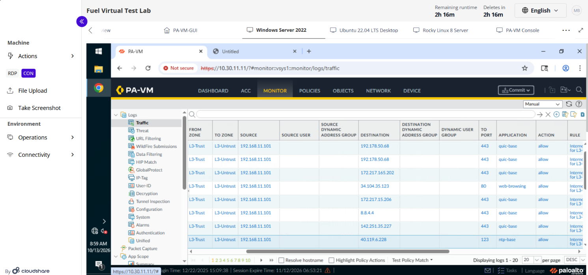
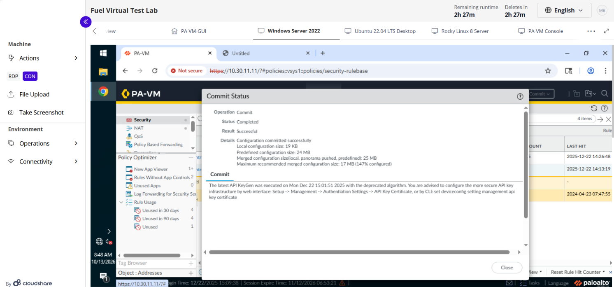

# Enterprise Edge Next-Generation Firewall (NGFW) UTM Deployment Lab

## 🌐 Project Infrastructure Overview
This project documents the successful deployment and configuration of an on-premises enterprise perimeter defense boundary using a virtualized **Palo Alto Networks VM-Series Next-Generation Firewall (PAN-OS 11)**. 

The lab topology replicates a production network architecture designed to segregate administrative access, internal corporate assets, public servers, and untrusted public spaces into distinct security segments.

### 🗺️ Network Architecture Map
*   **Management Segment (`10.30.11.0/24`):** Isolated out-of-band network used to securely access the firewall Control Plane.
*   **L3-Trust Segment (`192.168.11.0/24`):** Secure internal corporate data segment hosting core administrative endpoints and client hosts.
*   **L3-Intranet Segment (`10.80.1.0/24`):** Protected internal network housing production web application and database servers.
*   **L3-Untrust Segment (`172.16.1.0/24`):** Public-facing internet WAN gateway interface.

---

## 🛠️ Implemented Engineering Scenarios

### 1. Layer 3 Routing & Zone Boundaries
Configured virtual data plane interfaces to operate at OSI Layer 3 (Network Layer) by provisioning specific logical IP addresses, subnet masks, and binding them to independent security zones. This enforces a Zero-Trust perimeter where traffic between different logical segments is blocked by default.

### 2. Source Network Address Translation (NAT)
Engineered top-down **Source NAT rules using Dynamic IP and Port (DIPP)** translation. This allows multiple internal hosts residing on non-routable private IP subnets (`192.168.11.0/24` and `10.80.1.0/24`) to translate packet headers dynamically into a single public-facing, routable IP address (`172.16.1.1`) to communicate with internet nodes.

### 3. Layer 7 Unified Threat Management (UTM) Implementation
Graduated basic port-permissive access rules into deep payload inspection policies. Enabled and attached advanced scanning engines to inspect traffic payloads in real-time, matching traffic against active signature databases:
*   **Antivirus (AV):** Active signature tracking to scan, identify, and drop malicious wire file structures traversing the perimeter.
*   **Vulnerability Protection (IPS):** High-severity `strict` processing engine to analyze traffic payloads and drop network exploits or remote code execution attempts inline.
*   **URL Filtering:** Web categorization security rules to regulate, monitor, and restrict host access to unapproved web infrastructure.

---

## 🔍 Laboratory Verification Artifacts

### 📊 Artifact 1: System Dashboard Overview
Validates active Control Plane operations, showing a secure out-of-band management login session originating from the local administrative host (`10.30.11.101`) to the firewall's administration GUI (`10.30.11.11`).

### 📈 Artifact 2: Data Plane Traffic Log Verification
Provides production proof of execution. Captures the firewall actively performing Layer 7 identification (classifying traffic streams as `ssl`, `web-browsing`, and `quic-base`) and processing packets through the newly configured security policies.

### 💾 Artifact 3: Candidate Configuration Commit Success
Demonstrates the two-stage configuration model by validating configuration syntax and successfully writing the candidate configuration changes to the active operational running configuration memory.

### 🎥 Interactive Video Walkthrough
Click the link below to view a comprehensive video demonstration detailing the active security policies, interface mappings, and Unified Threat Management configuration matrices:

👉 **[Watch the Palo Alto NGFW UTM Lab Deployment Video Walkthrough on YouTube](https://youtu.be/uHD2kCJ3WbA)**

---

## 🧠 Architectural Concept Decoder
*   **Control Plane:** The background processing architecture responsible for administrative tasks, rendering the management GUI, managing logging databases, and parsing configuration instructions.
*   **Data Plane:** The specialized network processing architecture responsible for wire-speed packet switching, routing lookups, NAT translations, and Layer 7 threat signature matching.
*   **Two-Stage Configuration Model:** A system workflow separating working modifications (Candidate Configuration) from live device instructions (Running Configuration), providing a safety gate to validate syntax before altering production traffic rules.
*   **Idempotency / Top-Down Processing:** A linear processing logic where policies are evaluated sequentially from top to bottom. The first rule to successfully satisfy packet parameters executes its action and terminates further policy evaluations.
*
